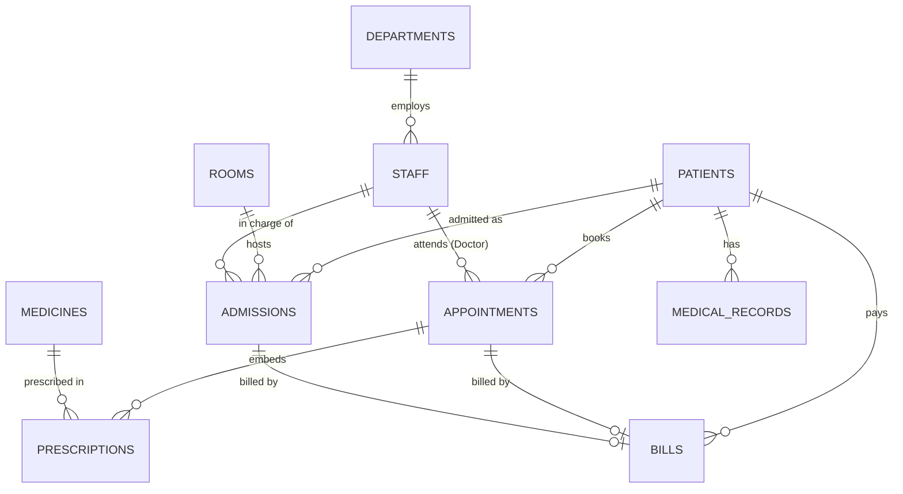

# Hospital Management System

ADBMS mini project: a hospital management system built on **MongoDB** with a **Python Flask** web front end.

The business rules (OPD hours, stock checks, automatic billing, room booking) are Python functions in `services.py`. Each one checks its rule and then writes with an atomic conditional update, so two requests can't both take the same room or the last tablets. Collections also have `$jsonSchema` validators and unique or partial indexes, so the database itself rejects bad data.

## Features

| Module | What it does | MongoDB feature behind it |
|---|---|---|
| Patients | Register, search, edit, delete; export a full record as XML or JSON | embedded `address` document, `allergies` array with a multikey index, `$regex` search, `$jsonSchema` validation of phone/email/enums |
| Staff | Doctors and nurses as subclasses of staff | one `staff` collection with a `role` discriminator (EER specialization) |
| Appointments | Book, prescribe, complete, cancel | unique index `uq_doctor_slot`, prescriptions embedded in the appointment, atomic stock decrement, bill created on completion |
| Admissions | Admit and discharge in-patients | atomic room claim with `find_one_and_update`, overlap check on stays, partial unique index `uq_one_active_admission` |
| Billing | OPD and IPD bills, mark paid | `$lookup` joins, `$group` aggregation per patient, partial index on unpaid bills |
| Pharmacy | Stock levels, restock low items | `$expr` query (`stock_qty < reorder_level`) walked with a cursor |
| Medical records | Lab reports (free-form documents) and discharge summaries (XML) | schemaless `details` sub-document, index on `details.flag` |
| Reports | Monthly revenue, doctor workload, abnormal labs, audit log | `$out` materialized collection, cursor over doctors, nested-field query, audit log collection |

## Project structure

```
app.py                      Flask routes
db.py                       MongoDB connection, id counters, audit log, error messages
services.py                 business rules and read queries (aggregation pipelines)
init_db.py                  creates hospital_db: validators, indexes, sample data
sample_data.py              demo data (bills come from completing / discharging)
mongo/hospital_mongo.js     MongoDB lab script: CRUD, indexes, aggregation, embedded vs referenced
templates/, static/         HTML pages (Bootstrap is bundled, works offline)
database/                   the original PostgreSQL scripts, kept for reference (not used by the app)
```

### Collections

| Collection | Holds |
|---|---|
| `patients` | patient with embedded `address` and `allergies` array |
| `staff` | doctors and nurses (`role: "Doctor"` / `"Nurse"`) |
| `departments`, `rooms`, `medicines` | reference data |
| `appointments` | visits, each with an embedded `prescriptions` array |
| `admissions` | in-patient stays (`status: Admitted / Discharged`) |
| `bills` | one per completed appointment or discharged admission |
| `medical_records` | lab reports, vitals, discharge summaries (`details` + optional `summary_xml`) |
| `audit_log` | every insert/update/delete on patients, admissions and bills |
| `mv_monthly_revenue` | monthly revenue, rebuilt by an aggregation with `$out` |
| `counters` | integer id sequences |

## Setup

### 1. Install

* MongoDB Community Server 6.0 or newer (https://www.mongodb.com/try/download/community). On Windows, install it as a service so it starts automatically.
* Python 3.10 or newer
* `mongosh`, only for the `mongo/hospital_mongo.js` lab script

### 2. Configure

```bash
python -m venv venv
venv\Scripts\activate            # Windows
# source venv/bin/activate       # macOS / Linux
pip install -r requirements.txt

copy .env.example .env           # Windows   (cp on macOS / Linux)
```

The defaults in `.env` connect to `mongodb://localhost:27017`. Change `MONGO_URI` if your server runs elsewhere or needs a username and password (MongoDB Atlas works too).

### 3. Create the database and run the app

```bash
python init_db.py
python app.py
```

Open http://127.0.0.1:5000. Run `python init_db.py` again any time you want to reset to the sample data.

### 4. Run the lab script

```bash
mongosh mongo/hospital_mongo.js
```

## Things to try in the app

* Book an appointment at 22:00. It is refused (OPD hours are 08:00 to 20:00).
* Book two appointments for the same doctor at the same time. The unique index refuses the second.
* Prescribe 1000 tablets of Clopidogrel. It is refused for insufficient stock. Prescribe a normal amount and watch the stock drop on the Pharmacy page.
* Complete an appointment. Its bill appears automatically (consultation fee plus medicines).
* Admit a patient into room P-302, which is under maintenance. It is refused.
* Discharge a patient. The room becomes available again and the IPD bill is generated.
* Open Reports to see the audit log entries written for every change.

## Data model



Prescriptions are embedded inside their appointment (always read together). Everything else is referenced by integer id and joined with `$lookup` when needed.

## How the project maps to the ADBMS syllabus

| Unit / Lab | Where it is in this project |
|---|---|
| Unit 1, Lab 1: EER model, specialization/generalization | `staff` collection with `role` discriminator; ER diagram above |
| Unit 3: object / semi-structured data | embedded documents, arrays, schemaless `details` |
| Unit 4 / CO2: query processing and optimization | single, compound, multikey, unique and partial indexes (`init_db.py`) |
| Unit 5, Lab 8: XML and JSON | XML and JSON export of a patient record, XML discharge summaries |
| Unit 6: active and temporal databases | audit log written on every change, overlap check on room stays |
| Unit 7, Labs 9-10: MongoDB CRUD, indexing, aggregation, embedded vs referenced | the whole app, plus `mongo/hospital_mongo.js` |

The original PostgreSQL scripts (PL/pgSQL, partitioning, SQL/XML, roles) are still in `database/` if you need them for the SQL labs. They need a PostgreSQL server and are not used by the app.
